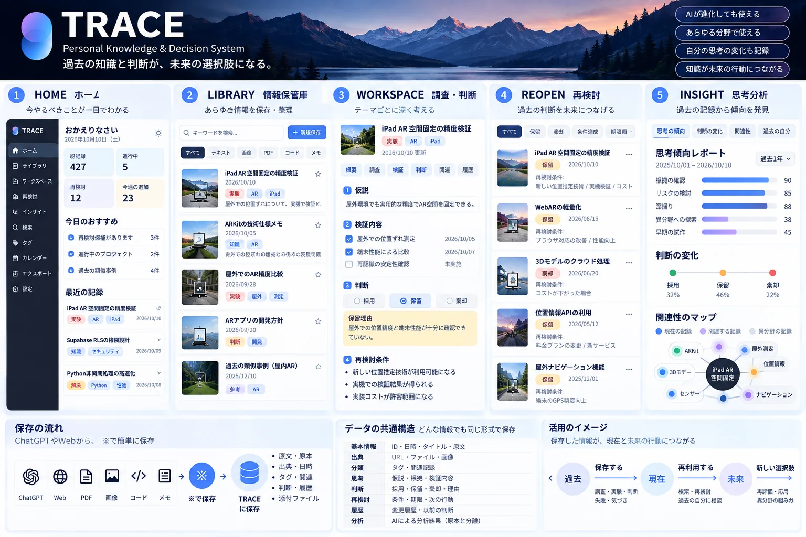

# TRACE｜知識と判断を未来につなぐシステム

保存日：2026年10月10日

## 概要

TRACE（Personal Knowledge & Decision System）は、過去の知識と判断を未来の選択肢につなげる構想です。この資料は利用者が提供した画面構想画像の内容を整理したもので、実装済み機能を示すものではありません。

## 5つの画面

- HOME：今やるべきこと、総記録数、進行中の活動、再検討、最近の記録を確認する。
- LIBRARY：テキスト・画像・PDF・コード・メモを保存し、検索・分類する。
- WORKSPACE：テーマごとに仮説、検証内容、判断理由、再検討条件を記録する。
- REOPEN：採用・保留・棄却した判断を、条件成立や期限に合わせて再検討する。
- INSIGHT：過去の記録から思考の傾向、判断の変化、記録同士の関連を確認する。

## 保存と共通データ

ChatGPTやWebから、明示的な「※保存」の指示で資料を保存する。原文・原本、出典・日時、タグ・関連、判断・履歴、添付ファイルを保持する。

共通データは、ID・日時・タイトル・原文、出典URL・ファイル・画像、分類、仮説・根拠・検証内容、採用・保留・棄却と理由、再検討の条件・期限・次の行動、変更履歴・以前の判断、分析を想定する。

## 活用のイメージ

過去の調査・実験・判断・失敗・気づきを保存し、現在の検索・再検討で再利用する。未来の再評価・応用・異分野の組み合わせから新しい選択肢につなげる。

## 添付画像

元画像：ChatGPT 画像 2026年10月10日 09_58_09.png（利用者提供）。保管庫取り込み用にWebPへ変換。元画像は変更せず、表示用ファイルにEXIF等を引き継がない。

IDEA VAULTではログイン後の確認に「はい、読み込み開始」と答えると、本文・日付・タイトルと上記画像を取り込む。実Supabaseへの保存は、このGitHub保存時点では未実施。
